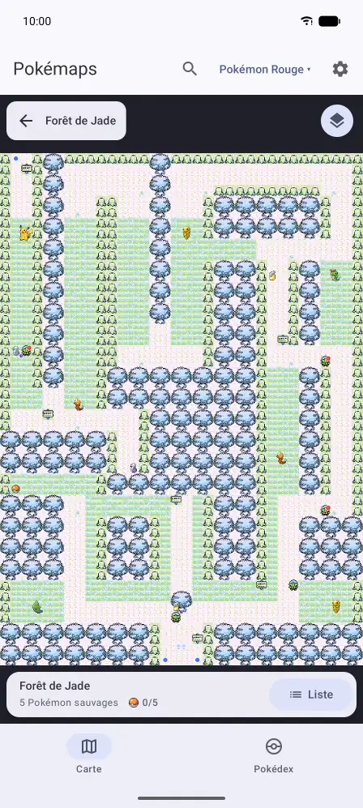
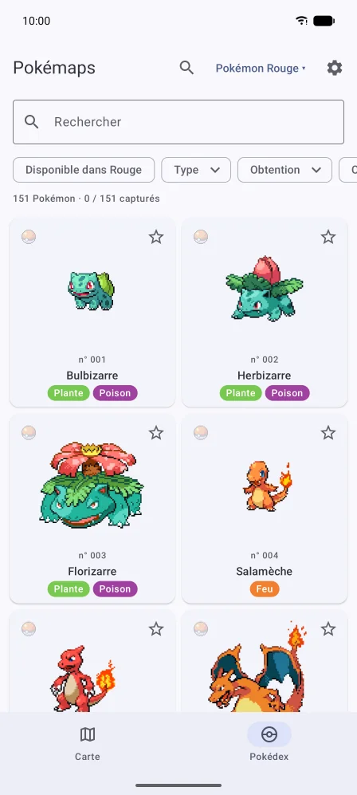
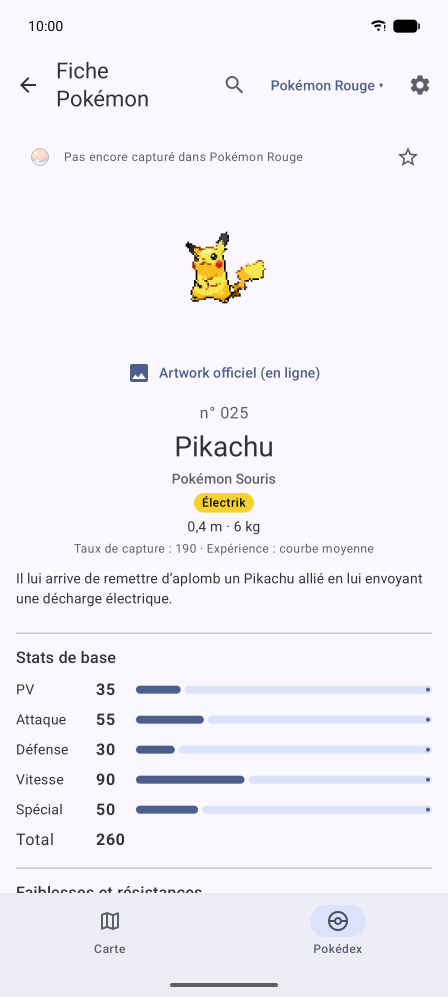
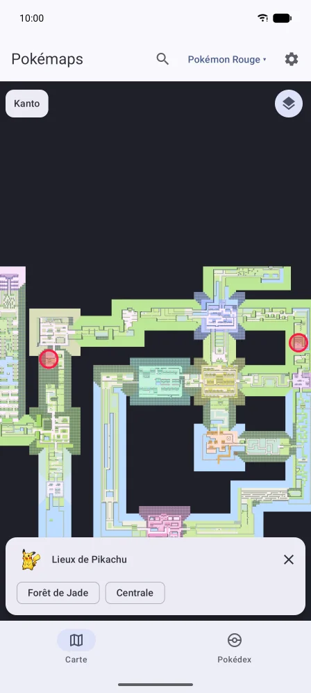
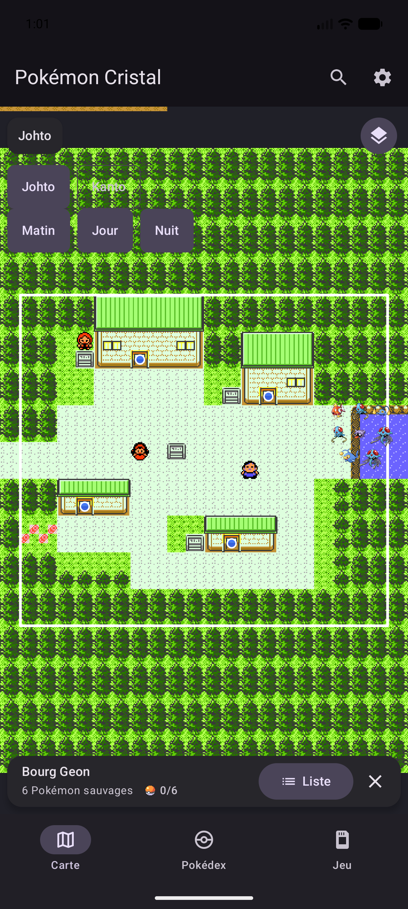
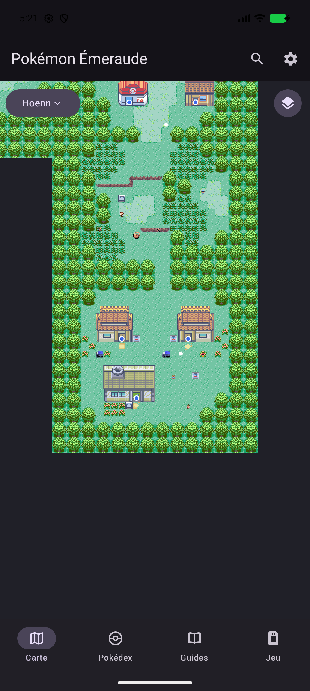
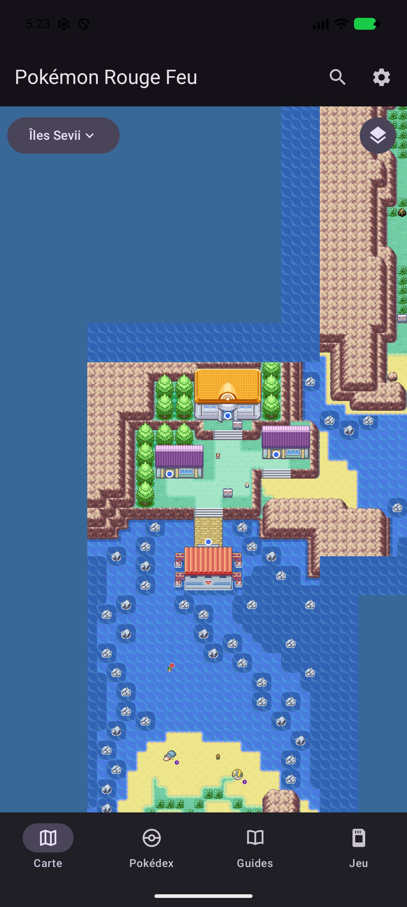

# Pokémaps

Application Android de **cartes interactives pour Pokémon Rouge, Bleu, Jaune, Or, Argent, Cristal, Rubis, Saphir,
Émeraude, Rouge Feu et Vert Feuille**, en français : cartes de Kanto, Johto, Hoenn et des Îles Sevii, Pokémon de chaque lieu,
fiches Pokémon (évolutions, attaques, CT/CS, chromatique), fiches des
attaques (effet et probabilité de l'effet) et Pokédex.

- Kotlin + Jetpack Compose, **Android 17 (API 37) minimum**
- **Aucun service Google Play** : l'application fonctionne sur GrapheneOS
- Cartes, Pokédex, guides et listes de succès entièrement hors ligne : toutes leurs données sont embarquées.
  Une connexion RetroAchievements facultative lit la progression du compte, uniquement sur demande dans les Réglages.
- Identifiant de l'application : `org.opensources.pokmaps`

Le jeu se choisit dans l'onglet « Jeu » de la barre du bas, classé par génération, et reste mémorisé. Dans les
Réglages, « Captures comptées » fait compter un Pokémon capturé pour le jeu choisi, pour sa génération ou pour tous
les jeux ; chaque capture reste mémorisée dans le jeu où elle a été cochée, si bien que changer ce réglage ne perd
rien.

Dans le Pokédex et les fiches Pokémon, un échec d’enregistrement d’une capture ou d’un favori affiche un message.
La collection conserve ses valeurs précédentes ; toucher à nouveau le bouton permet de réessayer.
Des identifiants ou valeurs de collection corrompus provoquent une erreur de lecture sans effacer les préférences.
Les identifiants positifs dans leur format décimal canonique restent acceptés pour conserver les sauvegardes de versions futures ; une portée de
captures inconnue revient toujours au réglage par défaut. Un catalogue de jeux vide signale également une erreur.

L'onglet « Guides » rassemble les étapes de la soluce, quêtes annexes, astuces, bugs et succès du jeu choisi.
Les guides se lisent sans case de fin de lecture ni liens de sources. Dojo et fossiles, Lugia et Ho-Oh ont chacun
leur article. Or, Argent et Cristal ajoutent les événements hebdomadaires, un vérificateur de reproduction
(sexes, groupes d'œufs, DV et héritage des attaques), avec recherche des parents par nom ou numéro, et un calculateur
de gains de bonheur. Le premier parent se choisit dans une fenêtre avec numéros, sprites et recherche ; le second
est proposé automatiquement (même espèce de sexe opposé, sinon Métamorph ou un partenaire compatible).
La liste du second parent contient uniquement les partenaires compatibles selon les groupes d’œufs et le sexe,
avec les exceptions pour Métamorph et les Pokémon sans sexe. Les espèces stériles affichent un avertissement.
Le sprite à droite ouvre la fiche,
et le résultat affiche aussi le sprite du Pokémon qui éclora. Les noms dans les textes ouvrent des fiches compactes
reliées au Pokédex et à la carte.
Les sprites et leur réglage d'animation sont réutilisés. Les chapitres proposent les succès liés, en signalant
les objectifs manquables avant de poursuivre.

Les cinq jeux GBA proposent les outils de reproduction et de bonheur dans « Guides » → « Astuces ».
Ils proposent aussi douze chapitres de soluce par branche, des quêtes annexes, astuces et articles sur les bugs.
Hoenn distingue Rubis/Saphir d’Émeraude et ajoute un calendrier pour l’Île Mirage, les marées, la loterie
et l’horloge ; la Maison Piège figure dans les quêtes car ses défis dépendent des badges, pas du jour.
Les remakes couvrent Kanto et la mission du Rubis et du Saphir dans les Îles Sevii.
La reproduction utilise les parents du Pokédex National, six IV de 0 à 31, les talents possibles du bébé,
les attaques transmises dans l’ordre du moteur et les objets tenus : encens, Ballon Lumière et Pierre Stase.
Les IV affichés sont les valeurs parentales possibles, avec le tirage aléatoire restant ; aucun œuf précis
n’est prédit. Émeraude applique la Pierre Stase à la femelle, ou à Métamorph en priorité, et ajoute Électacle
à Pichu avec un Ballon Lumière. Les bonus de bonheur suivent le Grelot Zen, la Luxe Ball et le lieu de rencontre ;
les baies réduisant les EV sont propres à Émeraude et le massage de Nina aux remakes.

Les 1 003 succès officiels sont des instantanés en français : Rouge (93), Bleu (90),
Jaune (76), Or (72), Argent (75) et Cristal (113), conservés du 8 octobre 2026 ; Rubis (49), Saphir (49),
Émeraude (197), Rouge Feu (61) et Vert Feuille (128), exportés le 12 octobre 2026.
Les titres GBA sont adaptés en français, les conditions officielles sont traduites intégralement.
Sans connexion configurée, les cases et le compteur suivent les
validations manuelles locales. Avec une connexion configurée, seuls le compteur RetroAchievements et les succès
synchronisés sont affichés ; les coches manuelles sont conservées pour une déconnexion ultérieure.
Le compteur de captures utilise uniquement les captures de la version choisie ; les objectifs
de collection utilisent leur véritable objectif (124, 124, 129, 199, 199 ou 206) et excluent les espèces nécessitant
un échange externe ou un événement externe. Les choix de Pokémon de départ, de fossile, du Dojo, d'évolution
d'Évoli en génération 1 et de pierres élémentaires limitées dans Or/Argent sont comptés par alternative,
sans additionner des branches incompatibles. Les autres restrictions du succès restent à respecter dans le jeu.
Les textes ne constituent pas une lecture de la sauvegarde de l'émulateur.

Les jeux GBA ajoutent des collections régionale et nationale sans échange ni événement externe.
Les objectifs nationaux comptent 177 espèces dans Rubis, 178 dans Saphir, 212 dans Émeraude,
170 dans Rouge Feu et 171 dans Vert Feuille. Les choix de partenaire, fossile et Pierre Lune limitée
suivent chaque cartouche ; le partenaire de Kanto et son errant constituent un seul choix.
La reproduction permet les deux combattants du Dojo et les trois évolutions élémentaires d’Évoli
dans les remakes. Les 28 formes de Zarbi sont suivies dans leur quête des Ruines Tanoby.
Saphir n’a pas de succès officiel de collection complète ; son outil de collection reste disponible.

Dans l’accueil de « Guides », « Pokémon errants » mémorise la dernière route observée et ouvre sa carte.
Johto conserve ses observations séparées ; chaque jeu GBA ne conserve qu’un errant à la fois.
Rubis propose Latios, Saphir Latias, Émeraude explique le choix rouge/bleu de la télévision ;
les remakes indiquent Entei avec Bulbizarre, Suicune avec Salamèche et Raikou avec Carapuce.
Les routes proposées viennent du moteur de chaque jeu ; aucun prochain déplacement n’est prédit.

Les sauvegardes de collection gardent le schéma JSON 1 et acceptent jusqu'à 386 espèces et 28 formes de Zarbi.
L'import vérifie les versions contre les jeux de la base embarquée, puis les espèces et formes contre le jeu.
Les anciens fichiers, même sans champ `unown`, restent importables et fusionnent avec la collection existante.
La fiche de Deoxys et ses sprites suivent la forme du jeu ; Morphéo présente ses quatre formes météorologiques.
Les familles d’évolution excluent les espèces apparues après la génération du jeu choisi, sans se limiter au
Pokédex régional. Les évolutions suivent les conditions du groupe de versions ; une espèce historiquement présente
reste consultable même si son obtention exige un échange ou un événement externe. Après un changement de jeu,
une espèce qui n’existe pas encore est indiquée comme absente ; un profil incomplet provoque une erreur de lecture.
Les cartes, rencontres et offres de distribution portent la mention « événement externe ».

Dans les Réglages, renseigner le nom d'utilisateur et la **clé API web** RetroAchievements, enregistrer puis
choisir « Synchroniser ». Seul l'endpoint GET
[`API_GetGameInfoAndUserProgress.php`](https://api-docs.retroachievements.org/v1/get-game-info-and-user-progress.html)
est appelé, une fois pour chacun des onze jeux ; aucun succès ni compte n'est modifié. Aucune requête ne part au lancement ou
lors du choix d'un jeu. Les résultats acquis et hardcore restent disponibles hors ligne ; un échec de lecture
conserve la dernière synchronisation. La clé est chiffrée avec Android Keystore dans `noBackupFilesDir`, sans
trace dans les journaux ni export. « Déconnecter » supprime la connexion et son cache, sans toucher au suivi manuel.
Sur GrapheneOS, autoriser « Network » dans les permissions de Pokémaps pour cette connexion.
La permission Internet sert à cette option ; les cartes et le Pokédex n'utilisent aucune API réseau.

« Sauvegarde de collection » exporte un JSON `pokmaps-collection`, schéma 1, avec captures par version, favoris,
formes de Zarbi, étapes cochées et observations des Pokémon errants. L'import valide le document entier (taille maximale 1 Mo)
avant une fusion atomique : captures, favoris et étapes sont réunis ; une observation importée remplace celle du
même Pokémon ; dans les jeux GBA, elle remplace le choix d’errant précédent. Les autres réglages et les
identifiants RetroAchievements sont exclus. Le sélecteur de documents
Android choisit le fichier, sans permission de stockage générale.

Pour ajouter ou retirer un guide : modifier les définitions de `data/guide/` et les textes français de
`res/values/strings_guides*.xml` ; `strings_achievements.xml` contient les succès des générations 1 et 2,
et `strings_achievements_<jeu>.xml` les cinq ensembles GBA.
Les textes de Hoenn, de son calendrier et des remakes ont chacun leur fichier dédié ;
`strings_guides_gen3.xml` contient les outils GBA.
Les listes de succès sont séparées par jeu, avec identifiant officiel, points,
caractère manquable et chapitre associé. Les balises `[[pokemon:25|Pikachu]]`, `[[place:route-1|Route 1]]`,
`[[item:potion|Potion]]` et `[[character:oaks-lab:Prof. Chen|Professeur Chen]]` sont validées au chargement.
Les autres noms reconnus dans la base deviennent aussi des liens. `GuideRepositoryTest` charge les onze bibliothèques
contre la base générée et vérifie leurs liens et nombres de succès. Les soluces sont des textes originaux ;
leurs sources éditoriales et les désassemblages pret restent documentés dans les définitions du dépôt.
Les fournisseurs de guides sont choisis par branche avant leur construction ; seuls les succès du jeu choisi
sont construits. Les progressions et captures restent séparées des définitions éditoriales.

Les ensembles publics RetroAchievements des générations 1 à 5 sont archivés dans
[`tools/data/retroachievements/`](tools/data/retroachievements/README.md), avec inventaire SHA-256 et
traductions GBA dans `gen3_fr.csv`. Leur lecture et leurs tests hors ligne n’exigent aucune clé API.
La mise à jour explicite utilise `python tools/export_retroachievements.py`, qui demande la clé sans l’enregistrer.
Les ensembles des générations 4 et 5 sont préparés pour un travail futur ; ils n’activent aucun nouveau jeu.
Le [bilan des guides GBA](docs/generations/guides-gen3.md) précise les choix et sources.

Or, Argent et Cristal proposent Johto et Kanto via un menu de région en haut à gauche.
Les cartes de Hoenn montrent un héros garçon et Flora comme rivale, après le déménagement.
La maison du héros est à gauche de Bourg-en-Vol, celle de la rivale à droite. Les camions, déménageurs,
acteurs du sauvetage de Seko et décorations personnalisables des chambres sont masqués. Seko reste dans son laboratoire.
Chaque combat de Flora possède une seule icône ; son équipe dépend du Pokémon de départ choisi dans le jeu.
Les sbires, admins et chefs Aqua/Magma suivent la version choisie, avec leurs sprites et équipes.
Les combats scénarisés du Bois Clémenti, du musée, de la Caverne Fondmer et du Centre Spatial
restent attachés aux ennemis qui combattent ; les alliés et figurants conservent leur rôle.
Jaune affiche les quatre combats et équipes communes de Jessie et James, ainsi que les badges des combats du rival.
Les quatre premières équipes du rival de Jaune sont fixes autour d'Évoli ; ses équipes suivantes
varient selon les résultats des premiers combats.
Les journalistes des Routes 111, 118 et 120 gardent une seule paire par route ; les acteurs des revanches
restent dans le catalogue source sans répéter les sprites sur la carte.
Dans Rubis, Saphir et Émeraude, les niveaux Surface et Sous les eaux apparaissent uniquement après sélection
d’un chenal avec un accès de Plongée. Les Chenaux 124, 126, 127, 128 et 134 sont concernés ; Émeraude ajoute
les Chenaux 105, 125 et 129. Le Chenal 133 ne possède pas de zone sous-marine.
La Grotte Tréfonds propose marée haute, marée basse et salle de glace ; les remakes proposent
Kanto et les Îles Sevii dans le menu des régions, avec un départ à Bourg Palette.
Le menu donne aussi accès aux îles événementielles présentes dans chaque jeu : Île du Sud pour Rubis/Saphir,
puis Île Aurore, Roc Nombri et Île lointaine en plus pour Émeraude ; Île Aurore et Roc Nombri pour les remakes.
Un marqueur « Île Mirage » sur le Chenal 130 ouvre son plan conditionnel dans les trois jeux de Hoenn.
Le fond transparent des Îles Sevii utilise un bleu océan fixe, sans filtre animé ni tuiles supplémentaires.
Dans les onze jeux, les badges à droite permettent de changer d'étage. Les zones et salles d'un même niveau
s'affichent ensemble sur un plan. Chaque paire de passages reliés porte la même couleur ; les traits sont masqués
par défaut et le switch « Liaisons », présent sur les plans concernés, permet de les afficher dans ces couleurs.
Les maisons restent séparées, accessibles par leurs portes ; le Parc Safari réunit ainsi ses quatre zones.
Les assemblages et leurs positions sont relus dans `tools/data/map_plans.csv` (coordonnées en cases de 16 pixels).
Les passages viennent de pret ; les niveaux sans numéro explicite sont vérifiés dans les plans de
[L'Océane](https://bulbapedia.bulbagarden.net/wiki/S.S._Anne) et du
[Souterrain de Doublonville](https://bulbapedia.bulbagarden.net/wiki/Goldenrod_Tunnel).
Le Léviator fixe du Lac Colère utilise son sprite chromatique.
Le choix des jeux distingue les remakes par leur génération d’origine.
Les personnages et objets dessinés avec leurs sprites de carte gardent leurs dimensions d’origine au zoom courant,
y compris les personnages de 16 × 32 pixels des jeux GBA. Les PNJ ne sont pas réduits par la proximité d'autres
marqueurs ; leurs pieds sont ancrés au bas de leur case et leur badge de combat reste attaché à cette même case.
Le calque « Baies et Noigrumes » apparaît sur les cartes contenant des arbres à fruits.
Le bouton horaire apparaît si les rencontres du jeu ont des conditions horaires.
Il défile Matin, Jour, Nuit et Tout : il filtre les rencontres et anime la lumière ;
Tout conserve les couleurs originales. La liste du lieu a son propre filtre et regroupe les
rencontres identiques sur toute la journée sous « Tout le temps ».
Le filtre « Baies et Noigrumes » affiche les fruits correspondant à chaque arbre, avec leur sprite d'objet.
Le Pokédex des formes capturées de Zarbi est accessible depuis sa fiche.
Les onglets d'attaques par œuf et par tuteur apparaissent seulement si la fiche contient des attaques correspondantes.
Lors d'un changement de jeu, la carte conserve le lieu et la surbrillance au sein d'une même famille de cartes.
Une nouvelle sélection annule le chargement précédent. Chaque résultat reste lié à sa demande et au catalogue
du jeu ; un ancien chargement ne peut pas remplacer le lieu ou la fiche actuellement sélectionnés.
La troisième génération propose le filtre Plongée et ses marqueurs sous-marins,
la pêche de Barpau et les 28 formes de Zarbi pour Rouge Feu/Vert Feuille ; Hoenn ne propose pas ce suivi de formes.
Le calculateur GBA reproduit les quatre contrôles entiers et les sept nouvelles Balls, avec réglages de
Plongée, de tours écoulés et d’espèce déjà capturée ; il exclut le Parc Safari et utilise un IV des PV moyen.
Rubis, Saphir, Émeraude, Rouge Feu et Vert Feuille sont sélectionnables.

Hoenn et Remake 1G constituent deux branches distinctes : voir la
[génération 3](docs/generations/generation-3.md) et le [bilan avant Sinnoh](docs/generations/bilan-generations-1-2-3.md).

La [documentation complète](docs/README.md) est organisée par fonctionnalité et génération.
Le [catalogue de provenance des sprites](docs/donnees/sprites-pokemon.md) couvre les 1 025 espèces
de la source épinglée, y compris celles des jeux à venir.

Les fiches d'Or et d'Argent affichent les six statistiques, les objets tenus, le sexe, les groupes d'œufs,
les cycles d'éclosion et les attaques par œuf. Les évolutions précisent le bonheur, l'heure et les objets tenus.
Le calculateur de capture reproduit la formule et les Balls du jeu, avec ses défauts d'origine ; le niveau du
Pokémon de l'équipe, la pêche et le contexte de la Love Ball sont réglables. Cristal ajoute ses cartes (Tour de Combat,
salles des Ruines d'Alpha, Sanctuaire du Dragon), ses rencontres et échanges, les sept possibilités de l'œuf de la
Pension, Suicune à la Tour Ferraille et les attaques par tuteur. Le tuteur coûte 4 000 jetons ; les récompenses de
Buena affichent leur prix en points de la Carte Bleue.

Le menu des régions distingue la région sélectionnée. En deuxième génération, le bouton de la carte affiche
une icône animée au changement de moment (matin, jour, nuit ou tout). La liste des Pokémon d'une route ou d'un
bâtiment reprend ce choix à l'ouverture ; ses filtres de moment et de capture (tout, marche, pêche, surf)
restent locaux à la liste. Les points de Kanto retouchés en première génération sont repris en deuxième
génération lorsqu'ils correspondent encore au même terrain, avec des emplacements supplémentaires au besoin.

Les filtres de capture apparaissent seulement si la méthode possède des rencontres au moment choisi.
Une liste sans Pokémon ne propose aucun filtre. Les icônes matin, jour et nuit utilisent les dessins
Meteocons de Bas Milius, adaptés en vecteurs Android (version 3.0.0-next.10, style Flat, licence MIT
embarquée dans `app/src/main/assets/licenses/meteocons.txt`).

## Captures d'écran

| Carte et Pokémon sauvages | Pokédex | Fiche Pokémon | Lieux d'un Pokémon |
|---|---|---|---|
|  |  |  |  |

Pokémon Rouge, sur l'émulateur Android 17 (Pixel 9 Pro XL).

| Carte de Johto dans Pokémon Cristal |
|---|
|  |

Pokémon Cristal, sur le même émulateur Android 17 (Pixel 9 Pro XL).

| Hoenn dans Émeraude | Îles Sevii dans Rouge Feu |
|---|---|
|  |  |

Captures sur le même émulateur Android 17 (Pixel 9 Pro XL), le 12 octobre 2026.

## Structure

| Dossier | Contenu |
|---|---|
| `app/` | Application Android |
| `tools/` | Pipeline de données Python : génère la base `pokedex.db` et les images |
| `tools/data/` | Corrections relues à la main (noms français, notes, doublons) |
| `docs/screenshots/` | Captures d'écran du README |
| `.github/` | CI/CD (GitHub Actions) |

## Données

`tools/build_data.py` génère, dans `app/src/main/assets/` :

- `database/pokedex.db` : la base SQLite de l'application ;
- `sprites/` : sprites des Pokémon (un seul style partout, animé ou fixe, normal ou chromatique) et icônes
  d'objets ;
- `maps/` : cartes pixel-art de chaque jeu découpées en tuiles (cartes du monde de Kanto et de Johto et lieux à part),
  et sprites des PNJ.

Les jeux en cours d'intégration (`GAMES_IN_PROGRESS` dans `tools/pokemaps_data/games.py`, actuellement vide)
ne sont pas embarqués : `tools/build_data.py` les génère avec tous les autres dans un aperçu,
`tools/build/preview/` (même organisation, hors de Git), validé de la même façon. Les tests du pipeline et l'éditeur des
emplacements le lisent.

Toutes les images sont embarquées en WebP sans perte, plus léger que PNG et GIF à pixels identiques ; chaque
image convertie est relue et comparée à sa source, et la génération s'arrête si elle diffère.

Sources (les mêmes que [pokemaps.net](https://pokemaps.net)) :

- **[PokéAPI](https://pokeapi.co)**, via l'export CSV du dépôt [PokeAPI/pokeapi](https://github.com/PokeAPI/pokeapi) :
  Pokémon, noms et descriptions en français, types et stats par génération, attaques par jeu, évolutions, Pokédex,
  lieux et rencontres de chaque version ; objets tenus et talents, préparés pour les générations
  suivantes (vides en 1re génération). PokéAPI n'a aucune description française du Pokédex avant Pokémon Noir :
  la fiche nomme le jeu d'où vient le texte. Les CSV sont téléchargés lors d'une génération explicite, avec cache ;
  l'application n'appelle jamais l'API ([usage équitable](https://pokeapi.co/docs/v2#fairuse)).
- **[pokesprite](https://github.com/msikma/pokesprite)** : icônes d'objets.
- **[PokeAPI/sprites](https://github.com/PokeAPI/sprites)** : sprites animés de Noir/Blanc, normaux et chromatiques,
  seul style de sprite des Pokémon (carte, listes, fiches, Pokédex, évolutions, jaquettes dessinées de l'écran de
  choix du jeu). Le sprite fixe est la première image du sprite animé : même
  dessin, même taille. Les Réglages choisissent, endroit par endroit, où ils sont animés. Ces sprites n'existent que
  pour les Pokémon n° 1 à 649 (5 premières générations) : la génération s'arrête si un jeu en demande d'autres.
- **[pret/pokered](https://github.com/pret/pokered)** et **[pret/pokeyellow](https://github.com/pret/pokeyellow)**
  (désassemblages des jeux) : pour dessiner les cartes, à partir des blocs, tilesets, palettes Super Game Boy,
  connexions, warps, objets et PNJ, et ce que proposent les personnages (soins, boutiques, dons, échanges,
  lots du Casino et leur prix en jetons, distributeurs, fossiles ranimés) ; pour l'effet de chaque attaque, tel que
  le moteur de combat l'exécute (`data/moves/moves.asm`). Aucune ROM n'est utilisée.
- **[pret/pokegold](https://github.com/pret/pokegold)** (Or et Argent) et
  **[pret/pokecrystal](https://github.com/pret/pokecrystal)** (Cristal) : cartes de Johto et de Kanto, et rencontres
  aléatoires lues comme le moteur les tire (herbes et grottes par moment de la journée, surf, pêche, Coup d'Boule,
  Éclate-Roc, essaims, Concours de capture d'insectes, `data/wild/`), PokéAPI les décrivant mal pour ces jeux
  (moments de la journée perdus, emplacements d'essaim manquants) ; dons, Pokémon fixes et échanges restent ceux de
  PokéAPI.
- **[pret/pokeruby](https://github.com/pret/pokeruby)**, **[pret/pokeemerald](https://github.com/pret/pokeemerald)**
  et **[pret/pokefirered](https://github.com/pret/pokefirered)** : lecteurs de la troisième génération,
  testés sur leurs commits épinglés. `Gen3PretRepo` lit les cartes et événements JSON, les layouts de 16 px,
  les pixels indexés 4 bpp, palettes JASC et attributs de métatuiles u16 (Hoenn) ou u32 (remakes), ainsi que
  les effets d'attaques et leurs probabilités en pourcentage. Les sources C et assembleur sont sélectionnées
  par version, en anglais, révision 0, sans options de correction. Les effets français sont dans
  `move_effects.csv`, format `gen3`. Les layouts inutilisés ne sont pas chargés ; les données utilisées
  inconnues ou incohérentes arrêtent la lecture. Les cartes Hoenn sont rendues et embarquées séparément pour
  Rubis/Saphir et Émeraude, avec catalogues TSV, événements JSON et sprites de PNJ. Leurs rencontres,
  personnages et services sont intégrés à Room, conformément au
  [plan génération 3](docs/plan_gen_3.md). Rouge Feu/Vert Feuille disposent également de leurs cartes,
  rencontres, personnages et services distribués.
- **`tools/data/`** : quelques corrections et compléments relus à la main (accents, étages mal nommés,
  prix du Casino, Pokémon demandés en échange, doublons), noms français des cartes (`maps.csv`), des classes de
  dresseurs (`trainer_classes.csv`), des personnages et leur apparence (`npc_names.csv`, `npc_text_names.csv`) et
  des installations (`facility_names.csv`), lien entre cartes et zones de rencontre PokéAPI, par famille de cartes
  (`map_areas.csv`), zones et objets absents de PokéAPI (`extra_areas.csv`, `extra_items.csv` : l'ADN Berzerk
  et les lettres d'Or et d'Argent), Pokémon que les jeux d'une famille de cartes n'obtiennent que par échange avec
  un autre jeu (`transfer_only.csv`, contrôlé par famille : Hoenn et Rouge Feu/Vert Feuille séparément),
  personnages en double écartés (`npc_duplicates.csv` : un même personnage à plusieurs étapes du scénario), offres
  que les scripts ne disent pas simplement (`npc_offers.csv`, action `add` : échanges d'objets, jetons vendus,
  Pokémon de départ du labo du Prof. Chen, Balls de Fargas ; action `remove` : don qu'un autre personnage fait
  pendant la scène), texte de l'effet de chaque attaque (`move_effects.csv`, une ligne par effet du moteur ou par
  attaque particulière, avec sa probabilité en chances sur 256 relevée dans `engine/battle/effects.asm`) et placement
  des cartes là où les connexions ne suffisent pas : cartes ancrées dans une carte du monde (`map_anchors.csv`),
  connexions incohérentes écartées (`map_connection_skips.csv`) et ville ou route d'origine d'une carte atteinte de
  plusieurs côtés (`map_parents.csv`), et sens des drapeaux du scénario qu'exigent les offres
  (`story_events.csv`, voir ci-dessous).

Les objets temporaires sans position fixe sont aussi écartés dans `npc_duplicates.csv` : le sbire des caméras
du repaire Rocket est masqué à l'entrée, puis déplacé par chaque alarme ; sa position initiale dans le mur
n'est jamais affichée par le jeu.

Chaque offre de personnage dit aussi quand elle est possible : moments de la journée, jours de la semaine et étapes
du scénario. Ces conditions sont lues dans les scripts pret par une analyse de flot (`offer_conditions.py`,
`pret_conditions.py` pour Rouge, Bleu et Jaune, `pret_gen2_conditions.py` et `pret_gen2_presence.py` pour la 2e
génération) : une offre n'exige que ce qu'exigent tous les chemins du script qui y mènent, avec la présence du
personnage (moments de son object_event, rappels de la carte selon le jour ou le moment, drapeau qui le cache,
objets masqués au départ de la 1re génération, table de textes choisie par le script de la carte). Les tests faits
dans les routines du moteur (`engine/`), hors des scripts de carte, ne sont pas lus : l'hôtesse du Club Link de la
1re génération attend le Pokédex sans que l'application le dise. Le nom d'un drapeau ne suffit pas à dire ce qu'il
signifie (`EVENT_MET_BILL` est levé au début de Cristal et baissé quand on rencontre Léo) : `story_events.csv`
donne, pour chaque drapeau rencontré, la phrase à afficher quand il est levé ou baissé (vide s'il ne s'agit pas
d'une étape : drapeau du jour, appel téléphonique, détail de scène) et l'endroit de pret qui le change. Un drapeau
absent du fichier, une ligne inutilisée ou une offre jamais possible arrêtent la génération ; une offre que le jeu
ne permet jamais se retire dans `npc_offers.csv` (la CT12 de l'institutrice du passage, dans Cristal).

En troisième génération, la clé éditoriale d'un personnage est `Carte:local_id` (ou son numéro d'événement
si la source ne nomme pas l'identifiant local). `read_curated_object` applique les doublons puis les résolutions
de `npc_offers.csv` : l'action `resolve` remplace l'expression d'objet ou de capacité indiquée dans `expression`,
en gardant provenance, chemins de scénario et quantités du script. `@script:Nom` cible un script partagé ;
`source` distingue ses branches. Les conditions relues dans le moteur, les prix en Points de Combat et
les Pokémon compatibles sont conservés. Un lot de quiz choisi par un autre joueur est explicitement
personnalisé. `reason` indique la source relue. La commande suivante vérifie tous les objets des cinq versions
et produit `character_curation.json` avec leurs positions, exclusions et offres. Une expression non résolue
ou une correction inutilisée arrête la génération. Les autres effets des appels C restent à vérifier avant
l'export vers l'application ; ce rapport ne modifie pas les assets Android :

```powershell
python tools/build_data.py --gen3-curation-only --preview tools/build/preview/gen3-curation
```

Les sources sont figées sur des commits précis (`tools/pokemaps_data/sources.py`), la génération est donc
reproductible. La base est vérifiée après chaque génération (références cohérentes, probabilités de rencontre
qui totalisent 100 % pour chaque moment de la journée, chaque Pokémon obtenable par rencontre, évolution ou
reproduction…).

### Ajouter un jeu

Les jeux pris en charge sont listés dans `tools/pokemaps_data/games.py`. Ajouter un jeu demande :

- une ligne dans `games.py`, d'abord dans `GAMES_IN_PROGRESS` (le jeu est généré et validé dans l'aperçu sans entrer
  dans l'application), puis dans `GAMES` quand l'application sait l'afficher : Pokémon, attaques, objets et
  rencontres sont alors extraits de PokéAPI (avec les
  symboles pret qui distinguent ses versions, comme `_RED` et `_BLUE` pour les lots du Casino), et la jaquette de
  chaque version (`VersionCover` : Pokémon de la jaquette et couleur) ;
- une source de sprites pour ses Pokémon au-delà du n° 649 (`sprites.py`), s'il en a ;
- de nommer ses nouvelles classes de dresseurs et ses nouveaux personnages dans `tools/data/` (un nom
  manquant arrête la génération) ;
- de lire les données de base de ses espèces (`pret_species.py`) : taux de capture, cycles d'éclosion et groupes
  d'œufs sont écrits par groupe de versions ; un sexe ou une courbe d'expérience différents de PokéAPI arrêtent la
  génération, car ils sont encore communs à tous les jeux ;
- de choisir ou d'adapter son lecteur pret (`PretFormat`, `pret*.py`, `pret_gen2*.py`, `pret_gen3*.py`),
  avec `PretFormat.GEN3` pour pokeruby, pokeemerald et pokefirered, ses régions et villes
  de départ (`Game.regions`), ses palettes et son rendu (`maps_render*.py`) ;
- de vérifier ses variantes de format même s’il partage un lecteur : Cristal ajoute une seconde banque
  de tuiles, des scripts conditionnels et `warpfacing`, ainsi que des tables sauvages `map_id` ;
- de lire et valider ses nouvelles offres (ex. tuteur payé en jetons et récompenses de Buena payées en
  points), puis de les représenter dans les modèles du domaine et les ressources françaises ;
- de classer ses nouvelles méthodes de rencontre (ex. `headbutt`) dans `ObtainMethod` : une méthode inconnue
  fait échouer le chargement au lieu de disparaître en silence des filtres et de la carte ;
- de déclarer son groupe de versions dans `VersionGroup` (application), avec la même famille de cartes que
  `games.py` : un groupe absent est refusé au chargement des jeux, et la compilation signale chaque règle propre
  à un jeu (bonheur, Zarbi, guides, région de départ, Pierre Stase) à décider pour lui. Les matrices des onze
  versions (`VersionGroupMatrixTest`, `test_game_capabilities.py`) se complètent avec lui ;
- de lire les effets de ses attaques (`pret_moves.py`, `pret_gen2_moves.py` et `move_effects.csv`) : une
  attaque sans effet arrête la génération.

Les mécaniques propres aux générations suivantes sont prévues, et la fiche d'un Pokémon les affiche dès qu'un jeu les
connaît (`GenerationFeature` dans l'application) : objets tenus (2e génération ; PokéAPI ne les donne qu'à partir de la
3e, ceux de la 2e sont lus dans pret), chromatiques (1 chance sur 8 192, puis 1 sur 4 096 à partir
de la 6e génération), sexe, groupes d'œufs et cycles d'éclosion (2e génération) et talents, dont le talent caché
(3e et 5e générations). `tools/tests/test_future_generations.py` vérifie ces tables sur des jeux plus récents.

Taux de capture, cycles d'éclosion et groupes d'œufs sont ceux de chaque jeu, lus dans son désassemblage pret :
PokéAPI ne donne que les valeurs actuelles, fausses pour Rattatac (90 jusqu'à la 2e génération), Draco et
Dracolosse dans Jaune, Marill et Azumarill en 2e génération, Kyogre, Groudon et Rayquaza, et les groupes d'œufs
de Tarsal et de Kraknoix en 3e génération. Sexe, courbe d'expérience, taille et poids sont identiques dans les onze
jeux et restent communs ; `tools/tests/test_species_profiles.py` compare une même espèce entre originaux et remakes.

Les données Pokémon de la 3e génération sont intégrées séparément pour Hoenn et Rouge Feu/Vert Feuille
([plan d'intégration](docs/plan_gen_3.md)). Les tests du pipeline vérifient les Pokédex régional et National,
les espèces nécessitant un transfert, les noms français et les objets clés sur des bases réduites sans cartes.
Les tables événementielles B à I de la Grotte Métamo restent listées avec la mention « Événement externe » et
ne comptent pas dans l'obtention ; seule la table normale à Nosferapti est accessible sans distribution.
Les cartes distribuées sont dans `assets/maps/emerald` et `assets/maps/ruby-sapphire` ;
`assets/maps/firered-leafgreen` (Kanto et Îles Sevii) est également distribué.
Un aperçu PC des rencontres permet de modifier les emplacements (commande ci-dessous).
Les bilans des [cartes Hoenn](docs/generations/cartes-hoenn.md) et des
[cartes des remakes](docs/generations/cartes-remake-1g.md) décrivent les assemblages, variantes et mesures.

Les ressources finales de `app/src/main/assets/` sont versionnées avec Git classique, sans Git LFS :
base, sprites fixes et animés (normaux, chromatiques et formes de Zarbi), icônes d'objets, tuiles, sprites de PNJ
et licences. `assets.sha256` inventorie leurs chemins et empreintes. Les guides, succès traduits et vecteurs
Meteocons sont déjà conservés dans les sources Kotlin et ressources Android du dépôt.
Les caches, sources brutes et aperçus restent ignorés. Aucun build Android ne télécharge de contenu Pokémon.

## Éditeur des emplacements sauvages

Après une génération des données, lancer `python tools/map_editor.py` sur le PC. Tant que des jeux sont en cours
d'intégration, l'éditeur lit l'aperçu de tous les jeux (`tools/build/preview/`), sinon les assets de l'application.
Choisir les jeux (Rouge, Bleu et Jaune sont édités ensemble), la région (Johto ou Kanto pour Or et Argent ; un
bâtiment est rangé dans la région de la ville ou route d'où l'on y entre), la route ou le lieu, puis le terrain :
herbes ou sol pour la marche, eau pour le surf et la pêche, arbres pour Coup d'Boule et rochers pour Éclate-Roc (2e
génération). Seuls les lieux qui ont des rencontres sauvages sont proposés, et seuls les terrains où le jeu fait apparaître un
Pokémon : les herbes si la carte en a, le sol uniquement dans les grottes et bâtiments (pas dehors, ni dans la forêt de
Jade ou le Parc Safari, où la marche ne compte que dans les herbes), l'eau s'il y a du surf ou de la pêche, les arbres et
rochers seulement dans les cartes où le jeu en fait tomber ou surgir des Pokémon. La génération
applique la même règle et refuse dans `map_spots.csv` un terrain où aucun Pokémon ne peut apparaître. La liste affiche les
Pokémon à placer sur ce terrain, avec leur version, leurs niveaux et leur probabilité. Cliquer sur la carte ajoute un
emplacement, centré sur la case de 16 px ; cliquer sur un emplacement le retire. « Vider ce terrain » retire tous ses
emplacements.

« Carte affichée » permet de basculer entre Rouge/Bleu et Jaune, entre Or/Argent et Cristal, ou entre
Rubis/Saphir et Émeraude. Seuls les jeux possédant le lieu éditable sélectionné sont proposés ; si le lieu est
propre à un jeu, ce plan est choisi automatiquement. La validation des emplacements communs ignore les jeux
où le lieu est absent : leur absence ne bloque pas l'enregistrement. Le plan,
les rencontres et les calques suivent ce choix. La case « Points uniquement pour … » est décochée par défaut :
les ajouts et retraits concernent les emplacements communs à la famille. La cocher, rarement, limite la
retouche au groupe affiché. Lors de la première retouche propre à un groupe, les points communs
servent de départ ; la liste obtenue remplace ensuite les points communs pour ce terrain dans ce groupe.
Les modifications restent en attente pendant les changements de carte.

Les coordonnées du curseur et du centre de la case survolée s'affichent en bas à droite. Les boutons « + »,
« − » et la molette permettent de zoomer et dézoomer ; « Ajuster » remet la carte à la taille de la fenêtre.
Glisser avec le bouton droit déplace la carte agrandie. Les points invalides sont signalés en jaune avec « ! ».
La section « Erreurs à corriger » recense tous les problèmes : cliquer sur une erreur ouvre les jeux, le lieu
et le terrain concernés, puis centre la carte sur le point. « Retirer le point sélectionné » le supprime
des modifications en attente, même s'il est hors du lieu. Les corrections sont sauvegardées par
« Enregistrer toutes les cartes ». Le rapport local `tools/build/map_spot_errors.json` est actualisé
au démarrage, après chaque modification et lors de la validation ; aucune donnée n'est téléchargée.

Les cases « Afficher sur la carte » dessinent, à la taille de l'application, ce que la carte finale montre autour des
emplacements : entrées, objets et objets cachés, dresseurs, personnages et installations, Pokémon fixes. L'« aperçu des
Pokémon sauvages » (décoché par défaut) pose un sprite du terrain sur chaque emplacement pour juger la place qu'ils
prennent ; l'application, elle, choisit elle-même quel Pokémon va sur quel emplacement. L'éditeur lit les sources pret
déjà téléchargées dans `tools/.cache` par la génération.

Quand un terrain a moins d'emplacements que de Pokémon à y dessiner (dans la version qui en demande le plus),
l'application dessine un Pokémon tiré au hasard par emplacement ; les autres ne sont visibles que dans la liste du
lieu. La section repliable « Avertissements », sous les erreurs, recense ces terrains sur toutes les cartes ; cliquer
sur une ligne ouvre le lieu et le terrain concernés. Ces avertissements ne bloquent pas l'enregistrement. Un terrain
qui a des Pokémon à dessiner mais aucun emplacement est en revanche une erreur bloquante : aucun Pokémon n'y serait
affiché.

Les positions peuvent être communes à tous les jeux d'une même famille de cartes (`map_family` dans
`tools/pokemaps_data/games.py`) : Or, Argent et Cristal ont leur propre famille, et leurs emplacements ne se
mélangent pas à ceux de Rouge, Bleu et Jaune. Seuls les terrains réellement modifiés sont écrits dans `tools/data/map_spots.csv`
(colonnes `family,map_identifier,kind,x,y`, puis `version_group` dès qu'un groupe est ciblé ; une valeur vide
conserve la portée commune, une ligne sans coordonnées marque un terrain vide) ; les autres restent
calculés par la génération. Le bouton « Enregistrer toutes les cartes » valide localement les terrains et les
coordonnées, puis écrit les modifications dans `tools/data/map_spots.csv`. Il ne lance aucune génération,
installation, aucun téléchargement ni test. Les clics hors du terrain choisi sont refusés ; les points doivent
appartenir à ce terrain dans les jeux ciblés qui contiennent le lieu. Les anciens points invalides
restent visibles pour pouvoir les retirer ; ils bloquent l'enregistrement avec un message indiquant le lieu
et les coordonnées. L'éditeur utilise la base, les images et les sources pret déjà présentes sur le PC.
Le sol des grottes tient compte des zones accessibles avec Surf, même si aucun chemin terrestre ne les relie
à l'entrée. Or/Argent et Cristal ont parfois des plans différents : les erreurs précisent les versions qui
refusent la case, et le choix « Carte affichée » permet d'examiner les deux plans.
Pour intégrer ensuite les emplacements dans l'application, lancer explicitement `python tools/build_data.py`
puis les contrôles décrits ci-dessous.

## Compiler en local

Prérequis : Android SDK (API 37), git, et un JDK pour lancer `gradlew`. Python est nécessaire seulement
pour les contrôles Python et la mise à jour explicite des données.

Gradle exécute toujours la build sur **Temurin 21**, le JDK de la CI, quel que soit le JDK qui lance `gradlew`
(celui d'Android Studio, par exemple) : `gradle/gradle-daemon-jvm.properties` fixe ce critère et Gradle télécharge
ce JDK une fois s'il n'est pas installé. Sur un JDK 24 ou plus récent, ktlint (compilateur Kotlin embarqué) et le
protobuf de DataStore dans les tests JVM appellent `sun.misc.Unsafe`, que ces JDK signalent par un avertissement.

```bash
# Compiler et installer avec les assets du dépôt, sans tools/.cache
./gradlew installDebug
```

Vérifications lancées par la CI :

```bash
./gradlew ktlintCheck checkNoGoogleServices lintDebug testDebugUnitTest   # Android (tests UI compris)
./gradlew ktlintFormat                                                    # corrige le style Kotlin

cd tools
pip install -r requirements-dev.txt
ruff check . && ruff format --check .   # style Python
python -m pytest                        # tests sans cache ni téléchargement de contenu
```

Les tests d’architecture contrôlent les limites de 600 lignes par fichier et de 60 lignes par fonction
(PSI du compilateur Kotlin et AST Python), ainsi que les imports des couches, y compris le domaine Hoenn.
Le compilateur Kotlin est une dépendance de test uniquement, pour analyser la syntaxe sans heuristique textuelle.
Les contrôles Ruff des caractères ambigus restent actifs ; seuls l’apostrophe typographique, le tiret demi-cadratin,
le signe de multiplication et le signe moins sont autorisés pour les textes français et les formules.

`./gradlew checkAssets` vérifie chaque fichier de l'inventaire et son SHA-256 ; ce contrôle précède
la compilation et les tests JVM. Un fichier absent ou modifié provoque une erreur qui nomme le fichier.
`python tools/check_assets.py` vérifie aussi les références aux images et la cohérence de la base.
La validation refuse les méthodes de rencontre ou d’apprentissage que l’application ne sait pas afficher.
Le parcours des scripts GBA refuse les commandes absentes des catalogues des moteurs épinglés.
Ces commandes utilisent uniquement les ressources finales du dépôt, même si `tools/.cache` est absent et
les sources de contenu Pokémon sont hors ligne. Les outils Android, JDK et dépendances de compilation
peuvent toujours nécessiter un téléchargement.

### Mettre à jour les données

Exécuter la génération seulement pour modifier des données, des corrections éditoriales ou ajouter du contenu :

```bash
pip install -r tools/requirements-dev.txt
python tools/build_data.py
python tools/check_assets.py
cd tools
ruff check . && ruff format --check .
python -m pytest -q
python -m pytest -q -m pipeline
```

Pour modifier uniquement les cartes Hoenn, utiliser
`python tools/build_data.py --hoenn-maps-only`, puis les mêmes validations et tests du pipeline.
Cette commande régénère les deux variantes, leurs catalogues de personnages et Pokémon fixes, et leur
inventaire SHA-256 sans modifier la base Room. Une modification des données ou de la curation exige la génération complète.
Pour les cartes de Rouge Feu/Vert Feuille, utiliser
`python tools/build_data.py --remake-maps-only`, puis les mêmes validations et tests du pipeline.
La génération complète inclut les trois groupes de cartes GBA ; les options ciblées sont exclusives.

Pour préparer uniquement les rencontres de troisième génération sur les cartes versionnées :

```bash
python tools/build_data.py --gen3-encounters-only --preview tools/build/preview/gen3-encounters
python tools/map_editor.py --assets tools/build/preview/gen3-encounters
```

Cet aperçu contient les cinq versions, les rencontres pret, les taux du moteur, les conditions de scénario,
les errants et les terrains. Cet export ciblé laisse les calques des personnages et offres vides ;
leur intégration distribuée est terminée. Les cartes versionnées doivent déjà être présentes dans les assets.
Les sprites manquants
sont téléchargés aux versions épinglées, puis réutilisés depuis le cache. L'application et son inventaire
`assets.sha256` restent inchangés. `encounter_comparison.json`, dans l'aperçu, signale chaque table dont les espèces,
niveaux ou probabilités diffèrent de PokéAPI ; le [bilan des rencontres communes](docs/generations/rencontres-gen3-communs.md)
explique les écarts. `map_areas.csv` accepte une colonne facultative `version_group` : les lignes d'un groupe
remplacent les lignes communes de la même carte, notamment pour le Parc Safari d'Émeraude.

Pour examiner aussi les objets au sol et cachés de la phase 5 :

```bash
python tools/build_data.py --gen3-items-only --preview tools/build/preview/gen3-items
python tools/map_editor.py --assets tools/build/preview/gen3-items
```

Les positions et versions des objets sont exportées dans la base de l'aperçu ; `map_items.json` conserve en plus
les quantités, élévations, scripts et drapeaux de retrait. Les jetons cachés du Casino de Céladopole sont
conservés dans ce JSON ; leur calque attend la prise en charge du domaine. Les objets calculés de la Pyramide
relèvent de la branche Hoenn, pas des objets à position fixe.

Les équipes et revanches des cinq versions GBA se génèrent explicitement dans un catalogue préparatoire :

```bash
python tools/build_data.py --gen3-trainers-only --preview tools/build/preview/gen3-trainers
```

`trainers.json` conserve les 3 724 équipes, les quatre emplacements d'attaques calculées ou explicites,
les IV, objets tenus, objets de combat, combats doubles et les 632 séries de revanches avec leurs conditions.
Il indique les commits sources et relie les équipes aux événements des cartes. Cette commande inclut
aussi les rencontres et objets fixes de l'aperçu. Les noms du catalogue restent ceux des sources.
Les quatre CSV de noms français sont préparés ; les noms vides, les clés répétées, les classes et les sprites fixes
sans traduction arrêtent cet export. Les fiches Hoenn sont assemblées dans la base distribuée ;
les fiches de Rouge Feu/Vert Feuille sont également intégrées à la base distribuée.

Les briques Android du Pokédex GBA proposent le régional en premier (Hoenn ou Kanto), puis une bascule
vers le National. Les filtres et coches sont conservés entre les deux listes ; la fiche privilégie le numéro
régional et utilise le National pour les espèces hors région. Les talents ont leurs noms français et leurs
descriptions disponibles dans le jeu ; six talents n’ont pas de description française GBA dans PokéAPI.
Ces fonctions sont disponibles pour les cinq jeux GBA dans l’application distribuée.
Le schéma 15 reste commun au générateur et à Room ; les offres portent leur monnaie explicite.

Les fiches de personnages Hoenn incluent leurs offres et conditions de scénario. Le domaine et les ressources
françaises prennent en charge les tarifs en Points Combat et en cendres, le Maître des Capacités et les
services d’œuf et de retrait de la Pension ; la monnaie est explicite pour les ventes et les tuteurs.

Les Pokémon fixes de Hoenn se régénèrent avec `python tools/build_data.py --hoenn-fixed-only`.
Les catalogues versionnés `maps/ruby-sapphire/fixed_encounters.json` et `maps/emerald/fixed_encounters.json`
conservent les Regis, Groudon/Kyogre, Rayquaza, Électrode, Kecleon et les Latios/Latias de l'Île du Sud :
positions des Pokémon, niveaux, objets tenus, scripts, conditions et drapeaux de retrait.
Ils sont également inclus dans l'export de curation et affichés sur les cartes Android de Hoenn.
Kecleon exige le Devon Scope ; l'Île du Sud exige le Passe Éon distribué par événement.

Les Pokémon fixes de Rouge Feu/Vert Feuille se régénèrent avec
`python tools/build_data.py --remake-fixed-only`. Le catalogue versionné
`maps/firered-leafgreen/fixed_encounters.json` conserve onze rencontres par version : deux Ronflex
niveau 30, deux Électrode niveau 34, les trois oiseaux niveau 50, Mewtwo niveau 70,
Ho-Oh et Lugia niveau 70, Deoxys niveau 30. Les positions viennent des objets Pokémon,
même si un autre événement déclenche le combat. Scripts, conditions et drapeaux de retrait sont conservés ;
le Roc Nombri exige le Ticketevent et l'Île Aurore le Ticketaurore, distribués par événement externe.
Ce catalogue entre aussi dans `character_curation.json` ; les rencontres fixes sont affichées sur les cartes Android.

Les services de Hoenn sont intégrés à la base et conservés dans le catalogue `character_curation.json`, généré par
`python tools/build_data.py --gen3-curation-only --preview tools/build/preview/gen3-curation` :
fossiles de Devon, Pension, Casino de Lavandia, Atelier du Verre, Maître des Capacités, tuteurs et
comptoirs de la Zone de Combat. Les tarifs, monnaies et objets requis sont conservés ; le
[bilan des services Hoenn](docs/generations/services-hoenn.md) décrit cette préparation.

La génération complète écrit les catalogues `characters.json` de Rubis/Saphir, Émeraude et Rouge Feu/Vert Feuille :
personnages par version, objets fixes et conditions des scènes automatiques, avec leur commit source.
Ces catalogues sont validés hors ligne par `tools/check_assets.py`. Les jeux Hoenn proposent les caractéristiques
des baies sur leurs fiches d’objet et les profils des 43 baies dans le guide, les effets et enchaînements de Concours sur les fiches d’attaque,
des guides de culture et de Concours, des recettes de Pokéblocs et le catalogue des 120 décorations.
Ce dernier relie leurs boutiques et dons aux cartes, avec leurs prix en argent, jetons, cendres ou Points Combat.
Les propriétés d’une Baie Enigma personnalisée par événement ne peuvent pas être prédites.
`python tools/build_data.py --hoenn-content-only` régénère explicitement `hoenn.json` depuis les sources
épinglées et les catalogues de personnages versionnés, puis met à jour `assets.sha256`.
Les données GBA de pret font autorité ; les écarts avec les CSV PokéAPI des baies et des Concours restent
dans ce catalogue. Le [bilan des contenus Hoenn](docs/generations/contenus-hoenn.md) décrit leur portée.
Les bibliothèques couvrent les onze jeux : les cinq jeux GBA proposent les outils de reproduction et de bonheur.
Leurs soluces, succès officiels, objectifs de collection et observations des errants sont disponibles.

Le même export intègre les fossiles, la Pension de l'Île 4, les lots et achats de jetons du Casino
de Céladopole, les tuteurs uniques, l'Effaceur et le Cherche VS de Rouge Feu/Vert Feuille.
Les prix sont lus dans le JSON de pokefirered ; les conditions de scénario, le choix des fossiles
et la récompense du Mémorial de Tectonix sont conservés dans la base distribuée.
Le [bilan des services Remake 1G](docs/generations/services-remake-1g.md) détaille les tarifs et niveaux par version.

Les lecteurs d'offres GBA appliquent les drapeaux de présence des événements avant le parcours des scripts.
`story_events.csv` accepte aussi les comparaisons de variables (`operator,value,phrase`) ; une comparaison
non relue arrête sa traduction. Les six états du National et du starter de Johto d'Émeraude sont décrits.
Le [bilan de la phase 5](docs/generations/personnages-gen3-communs.md) décrit l'export et les conditions du National
relues dans les sources. Cette commande conserve les assets de l'application et son inventaire.

Les [rencontres de Hoenn](docs/generations/rencontres-hoenn.md) ajoutent un terrain distinct de Plongée,
les routes possibles des grottes Terra/Marine et les notes des rencontres particulières. Les emplacements
relus de Rubis/Saphir et d'Émeraude sont conservés dans `map_spots.csv` ; six petits terrains gardent des
avertissements de capacité documentés. Les séries non capturables de la Pyramide et du Reptile sont conservées
hors ligne dans `maps/emerald/facility_encounters.json`, régénéré par `--hoenn-maps-only`.
Les [rencontres des remakes](docs/generations/rencontres-remake-1g.md) conservent les lettres et probabilités
de Zarbi par chambre de Tanoby, les conditions d'accès aux Îles Sevii et les errants selon le starter,
après la remise du Saphir à Ciléo, à pied et pendant Surf. Les 3 294 emplacements de Rouge Feu/Vert Feuille
sont relus et conservés dans `map_spots.csv` ; quatorze petits terrains gardent des avertissements de capacité documentés.

La génération réutilise les CSV, désassemblages, images et conversions déjà présents dans `tools/.cache` ;
elle ne télécharge que les sources manquantes aux commits épinglés. Les tests bloquent les accès réseau.
Les tests `pipeline` lisent ces sources et restent séparés des contrôles ordinaires ; ils sont exclus par défaut.
Relire puis versionner ensemble les changements éditoriaux, scripts concernés et assets finaux, y compris
`assets.sha256`. Ne pas ajouter `tools/.cache`, `tools/build/preview` ni les fichiers temporaires à Git.

Les tests UI Compose tournent sur la JVM avec Robolectric, dans `testDebugUnitTest` : ni appareil ni émulateur.
Ils parcourent l'application complète sur la base générée (Pokédex → fiche → carte, recherche → lieu ou objet,
choix du jeu, réglages) ; une base versionnée absente fait échouer les contrôles.

`checkNoGoogleServices` fait échouer la build si une dépendance tire les services Google Play
(`com.google.android.gms`), Firebase ou Play Core.

### Dépendances et notes de version

`.\gradlew.bat dependencyUpdates` liste les versions stables disponibles sans modifier le
catalogue. Toute mise à jour reste manuelle et doit être vérifiée avec les contrôles du projet.

Seul avertissement restant : `Configuration.setVisible(boolean) method has been deprecated`, à la configuration
du projet. Il vient d'AGP lui-même (`BasePlugin` et `SourceSetManager`, appelés à l'application du plugin), pas
de notre build : Gradle le déprécie depuis la 9.1, AGP 9.4.1 exige Gradle 9.6 ou plus récent, et AGP 9.5.0-alpha08
l'appelle encore. Il reste affiché (`org.gradle.warning.mode=all`) ; vérifier sa disparition à chaque montée d'AGP,
et monter AGP avant que Gradle 11 ne retire la méthode.

Pour une prochaine release, ajouter une ligne française sous le marqueur `<!-- notes -->` dans
[`RELEASE_NOTES.md`](RELEASE_NOTES.md). Le workflow inclut ces notes dans la GitHub Release et,
après publication réussie, vide la liste dans un commit sur `main`. Si `main` contient déjà des
notes différentes de celles du tag, elles sont conservées pour la release suivante.

## CI/CD

- **CI** (`.github/workflows/ci.yml`), à chaque push et pull request : validation des assets versionnés, tests sans sources,
  ktlint, vérification sans Google Play, Android Lint, tests unitaires et APK debug
  (téléchargeable dans les artefacts du workflow pendant 14 jours).
- **Release** (`.github/workflows/release.yml`), à chaque tag `vX.Y.Z` : APK release signé publié dans
  [GitHub Releases](../../releases), avec son empreinte SHA-256.

Les workflows CI et release utilisent les assets du checkout : aucune génération, aucun cache de contenu
et aucun téléchargement de sources Pokémon. Le résumé indique la taille exacte de l'APK produit.
Les instantanés JSON RetroAchievements sont exportés et conservés en UTF-8 avec des fins de ligne LF,
afin que leurs empreintes SHA-256 restent identiques sur Windows et Linux.
Le workflow manuel `data-pipeline.yml` génère et teste séparément les données depuis les sources épinglées,
avec cache ; il ne publie rien et ne remplace pas la mise à jour locale des assets à versionner.

Mesure locale Windows du 12 octobre 2026, onze versions et sources en cache : génération complète et
validation en 398,85 s, pendant une exécution parallèle des tests du pipeline (mesure non isolée).
APK debug : 102 891 337 octets (98,12 Mio) ; cartes : 41 841 493 octets (39,90 Mio).
Cache des sources et conversions : 5 660 286 413 octets (5,27 Gio) ; objets Git : 56 811 Kio.
Ces mesures ne prédisent ni un premier téléchargement, ni une exécution CI, ni la taille de l'APK release.
Le workflow manuel du pipeline rapporte durée de génération, cache, assets et APK après génération.

Les téléchargements HTTP réessaient jusqu'à quatre fois en cas de coupure réseau, de délai dépassé ou de réponse
HTTP temporaire (408, 429, 500, 502, 503, 504), avec des pauses de 1, 2 puis 4 secondes. Les fichiers incomplets
sont supprimés à chaque échec ; un échec persistant arrête la génération en indiquant l'URL concernée.

### Publier une version

**Une seule fois** : créer la clé de signature et l'ajouter aux secrets du dépôt.

```bash
keytool -genkeypair -v -keystore pokemaps-release.jks -alias pokemaps \
  -keyalg RSA -keysize 4096 -validity 10000
base64 -w 0 pokemaps-release.jks > pokemaps-release.jks.base64
```

Dans GitHub, *Settings → Secrets and variables → Actions → New repository secret* :

| Secret | Valeur |
|---|---|
| `KEYSTORE_BASE64` | contenu de `pokemaps-release.jks.base64` |
| `KEYSTORE_PASSWORD` | mot de passe du keystore |
| `KEY_ALIAS` | `pokemaps` |
| `KEY_PASSWORD` | mot de passe de la clé |

⚠️ Conservez `pokemaps-release.jks` et ses mots de passe en lieu sûr, **hors du dépôt** : sans eux, il est
impossible de publier une mise à jour installable par-dessus l'application existante.

**À chaque version**, vérifier que les assets finaux et leur inventaire font partie du commit à publier.
Une mise à jour du code seule réutilise ces données sans les régénérer. Puis, au choix :

- pousser un tag :
  ```bash
  git tag v1.0.0
  git push origin v1.0.0
  ```
- ou, dans GitHub, *Actions → Release → Run workflow* en indiquant la version (ex. `1.0.0`) : le tag est créé
  sur le dernier commit de la branche choisie.

Le code de version Android est calculé à partir du tag : `MAJEUR × 10000 + MINEUR × 100 + CORRECTIF`.

## Installer sur GrapheneOS (Obtainium)

[Obtainium](https://github.com/ImranR98/Obtainium) installe et met à jour les applications directement
depuis leurs GitHub Releases.

1. Installer Obtainium (depuis ses GitHub Releases ou F-Droid).
2. *Ajouter une application* → URL : `https://github.com/sargo22341-prog/pokmaps`.
3. Obtainium installe la dernière version et signale les mises à jour.

Sans Obtainium : télécharger l'APK depuis la page Releases et l'ouvrir sur le téléphone.

## Mentions légales

Projet de fan, personnel et non commercial. Pokémon et les noms associés sont des marques de Nintendo,
Game Freak et The Pokémon Company ; les images des Pokémon, des objets et des cartes sont © Nintendo, Creatures
et GAME FREAK. Ce dépôt ne contient aucune ROM ni ressource extraite d'une ROM.
Le code de l'application est sous licence [MIT](LICENSE).
